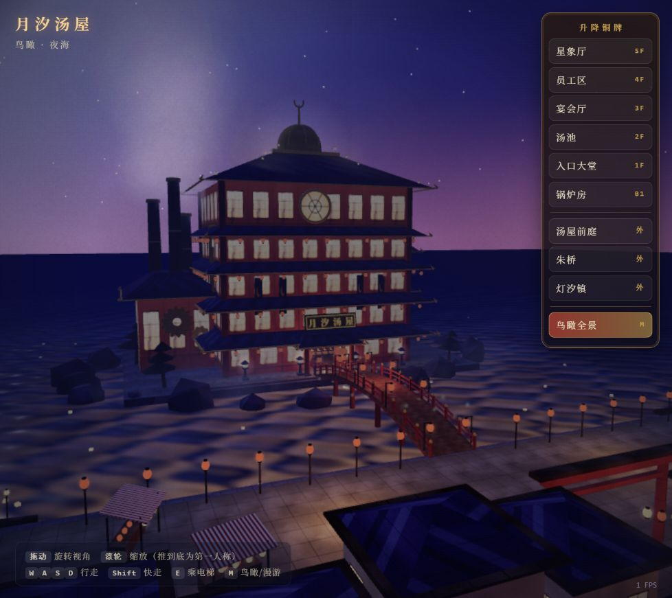

# 月汐汤屋

**FABLE5.2做的HTML世界**

夜海上的神灵旅馆，一个可以鸟瞰、漫游和探索楼层的 HTML 三维世界。

[在线体验](https://edoardo-zhang.github.io/yuexi-tangwu/)

## 本地体验

下载后打开 `index.html` 即可，无需安装依赖。页面内嵌 Three.js，模型与贴图由代码生成。

## 操作

- 拖动：旋转视角；滚轮：缩放。
- W / A / S / D：行走；Shift：快走。
- E：乘电梯；M：切换鸟瞰与漫游。
- 右侧「升降铜牌」：前往楼层与地点。
